<picture>
  <source media="(prefers-color-scheme: dark) and (max-width: 600px)" srcset="assets/bento-dark-mobile.svg">
  <source media="(max-width: 600px)" srcset="assets/bento-light-mobile.svg">
  <source media="(prefers-color-scheme: dark)" srcset="assets/bento-dark.svg">
  
</picture>

 

### Repositories

- **[MyType](https://github.com/duroey/MyType)** — Voice-first macOS desktop Agent control plane in Swift, built on Type4Me. Combines live dictation with Qwen3-Embedding session search, spoken intent routing, native Codex/Claude context handoff, and a unified menu-bar Inbox.
- **[dsh-study-tree](https://github.com/duroey/dsh-study-tree/blob/main/README.en.md)** — Branching session navigator plugin for DeepSeek Harness in TypeScript ([v0.1.6](https://github.com/duroey/dsh-study-tree/releases/tag/v0.1.6)). Forks persistent Agent sessions from selected spans or side questions so recursive detours keep the main thread clear.
- **[ai-hardware-inspiration](https://github.com/duroey/ai-hardware-inspiration)** — Combinatorial hardware ideation pipeline in Python across 51 sensors, 42 actuators, and 1,560 product carriers with Claude concept synthesis and Grok competitor lookup.

### Architecture Notes & Forks

- **[Quantitative Research Workbench](projects/quant-workbench.md)** — Decoupled price-volume scans, board-aware pairwise ranking, and time-bounded event reports across 210 snapshots and 98 dated pages *(source private)*.
- **[Second Brain](projects/second-brain.md)** — Local SQLite prototype compiling Codex and Claude transcripts into problem episodes, mechanisms, and ablation-checked cross-project trials.
- **[Xime](https://github.com/duroey/Xime/commit/29a966762b5c809b4f417312ca88136ad4b1f7c5)** · **[Sleepless](https://github.com/duroey/Sleepless/tree/agent/recoverable-full-awake-profile)** — Ordered audio and cancellation queues for voice input; configuration snapshots and crash recovery for unattended macOS wake locks.
