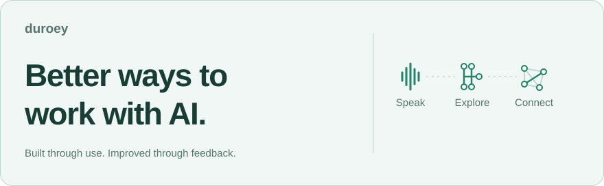
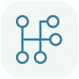

<picture>
  <source media="(prefers-color-scheme: dark) and (max-width: 600px)" srcset="assets/profile-dark-mobile.svg">
  <source media="(max-width: 600px)" srcset="assets/profile-light-mobile.svg">
  <source media="(prefers-color-scheme: dark)" srcset="assets/profile-dark.svg">
  
</picture>

  <a href="#selected-work">Selected work</a> &nbsp;&nbsp; / &nbsp;&nbsp;
  <a href="#further-explorations">Explorations</a> &nbsp;&nbsp; / &nbsp;&nbsp;
  <a href="#a-little-about-me">About</a> &nbsp;&nbsp; / &nbsp;&nbsp;
  <a href="mailto:duroeyli@gmail.com">Get in touch</a>

I turn everyday friction into tools for working with AI. My projects take me from
product questions and model experiments to engineering and feedback from use.
I am especially interested in how **voice, agents, and personal knowledge** can
become one continuous workflow.

## Selected work

<picture>
  <source media="(prefers-color-scheme: dark)" srcset="assets/mytype-dark.svg">
  
</picture>

### [MyType](https://github.com/duroey/MyType)

**Give spoken intent somewhere useful to go.**

Voice input often ends at a text box. I am exploring how it can connect to
ongoing agent work instead. Built on Type4Me, my extensions bring together
desktop session search, context handoff, and a shared Inbox.

[Explore the project](https://github.com/duroey/MyType) · macOS application · Public source

 

<picture>
  <source media="(prefers-color-scheme: dark)" srcset="assets/study-tree-dark.svg">
  
</picture>

### [DSH Study Tree](https://github.com/duroey/dsh-study-tree/blob/main/README.en.md)

**Follow a question without losing the thread.**

Learning with an agent often sends one question into several prerequisites.
I built a DeepSeek Harness plugin with real session forks and a tree navigator,
so each branch can be explored and the original discussion is easy to return to.

[See screenshots and installation](https://github.com/duroey/dsh-study-tree/blob/main/README.en.md) · Released plugin

 

<picture>
  <source media="(prefers-color-scheme: dark)" srcset="assets/second-brain-dark.svg">
  
</picture>

### [Second Brain](projects/second-brain.md)

**Make past conversations useful to the next idea.**

Agent history already holds selected information, experiments, and corrections.
I built a local prototype to index those records, extract problems and methods,
and propose connections across projects—with source checks and explicit feedback.

[Read the case study](projects/second-brain.md) · Research prototype · Source not yet public

 

## Further explorations

**[Quantitative Research Workbench](projects/quant-workbench.md)** 
From scattered market data to a reviewable research workflow: rule-based
screening, machine-learning ranking, event research, and dated reports.
My work spans data processing, model training, evaluation, and operations.
[System design and retained outputs](projects/quant-workbench.md) · Private source

**[AI Hardware Idea Explorer](https://github.com/duroey/ai-hardware-inspiration)** 
A structured way to explore product ideas: combine sensors, actuators, and
everyday product categories, then investigate possibilities with LLMs and
competitor research.

### Improvements driven by use

- **[Xime](https://github.com/duroey/Xime/commit/29a966762b5c809b4f417312ca88136ad4b1f7c5)** — Ordered startup audio, session queues, and cancellation handling for more reliable voice input.
- **[Sleepless](https://github.com/duroey/Sleepless/tree/agent/recoverable-full-awake-profile)** — Configuration snapshots, restoration, and failure recovery for unattended tasks.

Both adaptations live on separate branches and have not been merged into their default branches.

## A little about me

I like moving between **product, applied ML, and engineering**, especially when
using a tool myself reveals the next thing worth improving.

MSc student at the Institute of Computing Technology, Chinese Academy of
Sciences. My research group works on LLM training and inference systems.

[duroeyli@gmail.com](mailto:duroeyli@gmail.com)
