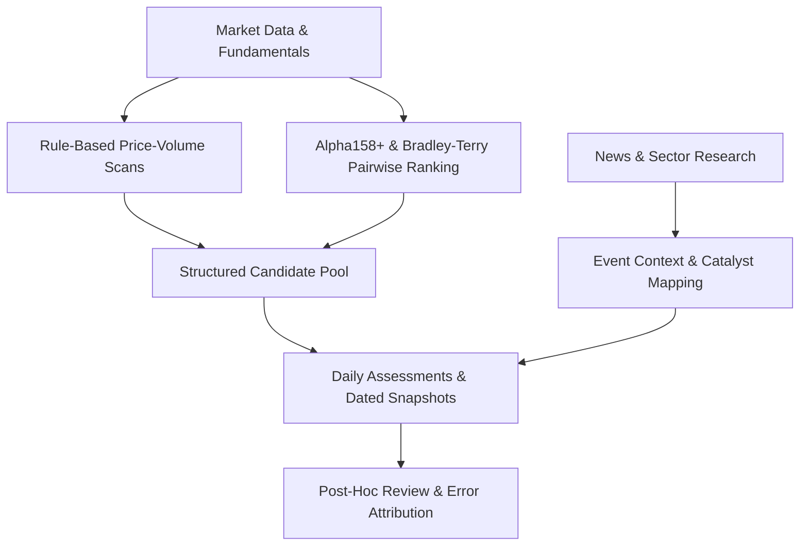

# Quantitative Research Workbench: Point-in-Time Screening, Pairwise Ranking & Event Research

> Combining rule-based price-volume scans, board-aware ML ranking, and evidence-bounded event analysis while preserving strict time boundaries.

**Status:** Private operational system; this case study covers the architecture and audited artifacts.  
[Back to profile](../README.md)

---

## Why Modularize Research Around Time Boundaries

Across thousands of equities and continuous news flow, two common failure modes break solo quant-research workflows:
1. Quantitative price-volume signals miss emerging sector narratives and supply-chain catalysts.
2. Unconstrained LLM market summaries mix duplicate headlines with post-close outcomes, turning hindsight rationalization into false confidence.

I decoupled the system into independent stages—screening, ML ranking, event context, and snapshot archival—with hard date boundaries separating inputs known before close from subsequent market moves.

## System Architecture

### 1. Rule-Based Candidate Discovery
Tracks daily and weekly breakouts and low-volume consolidations, logging exactly when candidates enter, persist, or exit the pool across refactored V1/V2 pipelines.

### 2. Board-Aware Pairwise ML Ranking (`StockRanker`)
Built on **Qlib + LightGBM**, extending Alpha158 with valuation, market cap, turnover, and board features under a **Bradley–Terry pairwise ranking objective** to optimize relative intra-day ordering. Main Board and ChiNext tickers are normalized and ranked separately, enforcing complete-label boundaries and training-validation purge gaps to avoid leakage.

### 3. Evidence-Bounded Event Context
Separates research synthesis cleanly from model training. Daily assessments track repeated headline rewrites, supply-chain transmission paths, and explicit timestamps distinguishing pre-close evidence from post-close observations.

### 4. Inspectable Historical Snapshots
Trading-day scoring and non-trading-day model retraining maintain decoupled state tracking (both raw data cutoffs and complete-label dates). Retaining agreements and conflicts between rules, ML ranks, and event notes keeps past decisions open to retrospective falsification.

## Audited Artifact Coverage

As of **2026-11-15** (archives verified through **2026-11-13**):

| Artifact Stream | Count | Coverage Window |
| --- | ---: | --- |
| StockRanker cross-sectional ranking snapshots | **210** | 2025-12-30 to 2026-11-13 |
| V2 rule-based candidate snapshots | **221** | 2025-12-15 to 2026-11-13 |
| Dated daily workbench report pages | **98** | 2026-06-17 to 2026-11-13 |

*Note: These counts measure system outputs across decoupled modules rather than net live trading return, which still requires independent transaction-cost and frozen-execution simulation.*
