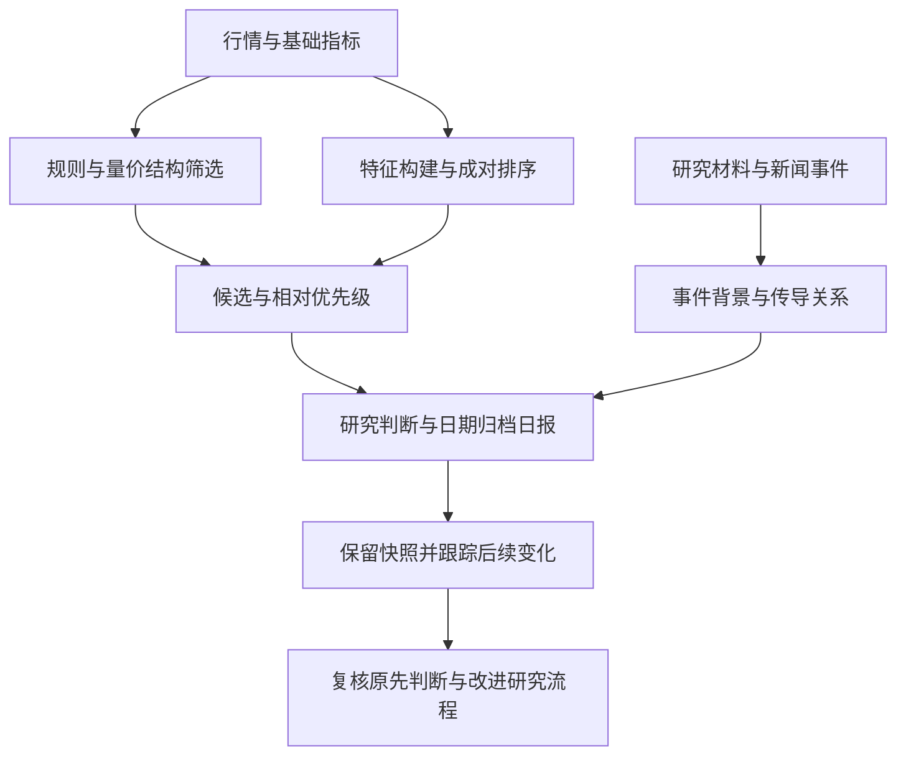

# 个人量化与投研工作台

我希望把每天分散的行情、模型信号和新闻资料，组织成一条可以持续跟踪、回头复核的研究流程。这个项目由规则筛选、机器学习排序和 Agent 辅助研究共同组成，重点是让研究注意力有依据，让判断过程留下记录。

[返回个人主页](../README.md)

## 为什么做

面对大量标的和不断更新的新闻，一个人很难同时完成候选发现、优先级排序、背景研究和后续复盘。

最初的规则筛选能够找出特定量价结构，但候选之间仍缺少相对比较。加入模型后，又需要弄清模型分数是否得到价格与事件背景支持。新闻数量增加，也会带来重复消息、时间错位和过度归因的问题。

我逐步把这些问题拆成不同模块：先缩小研究范围，再补充事件背景，最后保存判断依据，观察后续变化。

## 我怎样把它做成一个系统

### 从技术形态中发现候选

我先用日线、周线以及放量突破、缩量整理等量价结构建立筛选流程，记录候选的新增、维持和消失。规则模块给出一组有明确形成条件的研究对象，便于后续比较信号出现前后的变化。

这一部分经历了 V1 与 V2 的拆分和重构：数据下载、增量清洗、量化扫描、候选变化与回测各自有清楚的职责，历史输出按日期保留。

### 用机器学习安排研究优先级

为了比较候选的相对位置，我基于 **Qlib 与 LightGBM** 构建 StockRanker。在 Alpha158 上补充估值、市值、换手与板块特征，通过 **Bradley–Terry 成对排序**学习同一交易日内的相对次序。

我将主板和创业板分别标准化、分别排名，让研究者能够区分板块差异与个股相对变化。训练和预测共用特征处理，并通过标签完整日期与训练验证隔离期维护时间边界。

模型排序与规则筛选保留各自的判断。二者一致时可以继续研究，出现分歧时也要留下分歧，供后续复核。

### 把候选放回事件背景

工作台研究层由 Agent 辅助组织研究材料与新闻事件，将它们和行情、候选变化、模型排名共同呈现。

我的关注点是事件如何影响产业链、同一消息是否被重复改写，以及材料在当时是否已经可见。报告区分收盘前证据与盘后补充，也区分来源转述、条件性推断和价格实际表现，减少用后来的信息解释先前判断的偏差。

这一层负责研究组织与报告，和 StockRanker 的模型训练、预测分别维护。

### 让判断可以回看

我把完整排名、规则候选和研究日报按日期保存。后续复盘能够回到当时的版本，检查原先关注的理由、出现过的分歧，以及哪些条件后来没有成立。

交易日预测和非交易日训练也分开管理，训练状态同时记录源行情日期和标签完整日期。这样，数据到达、模型更新和研究产物之间的关系能够被追踪。

## 我的工作与关键判断

- **把研究过程拆成可协作的模块。**我负责将数据处理、规则筛选、模型排序、研究组织和历史留存串起来，各模块保留自己的输入、输出与职责。
- **选择贴近使用方式的模型目标。**研究首先需要相对优先级，因此在已有回归方案之外实现成对排序，并保留对照入口。
- **将时间边界写入系统。**执行日、未来观察窗口、标签完整日期和训练验证隔离期分别管理，避免把未来信息带入当时的判断。
- **用真实运行问题推动迭代。**补充基础指标、板块标准化、增量数据集检查和训练状态去重，并将研究搜参与日常固定参数训练分开。
- **把复核作为产物的一部分。**保留历史快照与报告，关注相对排序、量价信号和事件解释之间的一致或冲突，而不是只留下最终结论。

Qlib、LightGBM 和 Alpha158 提供基础框架与方法；我的工作重点是它们在个人研究流程中的适配、组合、实现和迭代。

## 已留下什么

盘点日期为 **2026-11-15**，下列归档产物均截至 **2026-11-13**：

| 产物 | 数量 | 日期覆盖 |
| --- | ---: | --- |
| StockRanker 完整横截面排名快照 | **210 份** | 2025-12-30 至 2026-11-13 |
| V2 股票候选快照 | **221 份** | 2025-12-15 至 2026-11-13 |
| 工作台日期归档日报页面 | **98 份** | 2026-06-17 至 2026-11-13 |

排名、候选和日报来自不同模块，统计口径分别保留。这些数字记录的是研究产物积累；期间模型与流程发生过迭代，收益有效性仍需在冻结策略、执行价格、交易成本和时间切分明确后单独评估。

目前可以展示的成果，是一条已经留下长期产物、能够按时间追溯的个人研究流程。它也让我持续处理模型目标、数据口径、业务解释与工程运行之间的关系。

## 当前边界与下一步

系统由多个独立源码仓库和工作台研究层组成。源码及日常运行配置目前不公开，本页提供经过整理的系统设计和产物概况。

后续我希望把复盘进一步标准化：冻结当时的候选与判断，在统一观察窗口内比较不同信号，记录它们何时互相补充、何时造成误导，再据此调整排序目标和研究流程。

这也是这个项目对我的意义：把信息收集、模型实验与产品使用连接起来，让每次研究都为下一次改进留下反馈。
