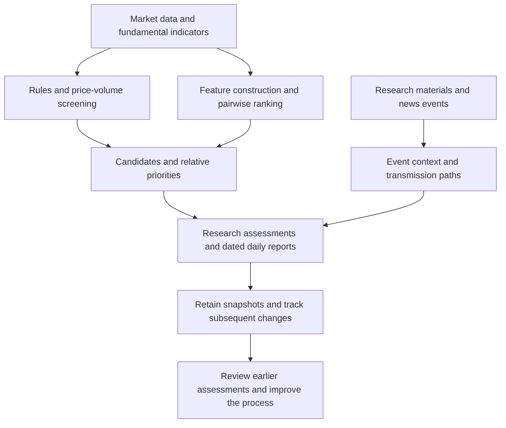

# Personal Quantitative Research Workbench

I wanted to turn scattered market data, model signals, and news into a research process that I could follow over time and revisit later. The project combines rule-based screening, machine-learning ranking, and agent-assisted research to make research priorities explicit and preserve the reasoning behind each assessment.

[Back to my profile](../README.md)

## Why I built it

With a large stock universe and a constant flow of news, one person can struggle to discover candidates, set priorities, research their context, and review what happened afterward.

The initial rules identified particular price-volume patterns, but did not provide enough comparison between candidates. Adding a model raised another question: whether its scores were supported by price behavior and event context. More news also introduced duplicate stories, timing mismatches, and over-attribution.

I gradually separated these problems into modules: narrow the research scope, add event context, then preserve the assessment and observe subsequent changes.

## How I organized the system

### Discover candidates from price-volume patterns

I first built a screening workflow around daily and weekly data, volume breakouts, and consolidation with declining volume. It records when candidates appear, persist, or disappear. Each candidate has explicit conditions behind it, making changes before and after a signal easier to examine.

This part evolved through V1 and V2 implementations and refactoring. Data downloads, incremental cleaning, quantitative scans, candidate changes, and backtesting have distinct responsibilities, with outputs retained by date.

### Use machine learning to set research priorities

To compare candidates, I built StockRanker with **Qlib and LightGBM**. I extended Alpha158 with valuation, market-capitalization, turnover, and board features, and implemented **Bradley–Terry pairwise ranking** to learn relative order within each trading day.

I normalize and rank Main Board and ChiNext stocks separately, helping distinguish board-level differences from a stock's relative movement. Training and prediction share feature processing; complete-label dates and a training-validation purge gap maintain the time boundaries.

Model rankings and rule-based screening retain their own assessments. Agreement can motivate further research, while disagreements are also recorded for later review.

### Put candidates back into event context

The workbench research layer uses an agent to help organize research materials and news events alongside market data, candidate changes, and model rankings.

I focus on how events might affect an industry chain, whether the same story has been rewritten repeatedly, and whether the material was available at the time. Reports distinguish evidence available before market close from later additions. They also separate source reports, conditional inferences, and observed price behavior, reducing the use of later information to explain an earlier assessment.

This layer handles research organization and reporting separately from StockRanker's model training and prediction.

### Make earlier assessments reviewable

I save full rankings, rule-based candidates, and research reports by date. Later reviews can return to the version available at the time, examine the original rationale and disagreements, and identify conditions that did not materialize.

Trading-day prediction and non-trading-day training are managed separately. The training state records both the source-data date and the latest complete-label date, making the relationship between data arrivals, model updates, and research outputs traceable.

## My work and key decisions

- **Divide the research process into collaborating modules.** I connected data processing, rule-based screening, model ranking, research organization, and historical retention while preserving each module's inputs, outputs, and responsibility.
- **Choose a model objective that matches its use.** Research needs relative priorities, so I implemented pairwise ranking alongside the existing regression approach and retained comparison entries.
- **Build time boundaries into the system.** Execution dates, future observation windows, complete-label dates, and the training-validation purge gap are managed separately to prevent future information from entering an earlier assessment.
- **Let operational problems guide iteration.** I added fundamental indicators, board-aware normalization, incremental-dataset checks, and training-state deduplication, and separated research hyperparameter search from routine training with fixed parameters.
- **Treat review as part of the output.** Historical snapshots and reports preserve agreement and conflict between rankings, price-volume signals, and event interpretations, rather than retaining only the final conclusion.

Qlib, LightGBM, and Alpha158 provide the underlying frameworks and methods. My work focuses on adapting, combining, implementing, and iterating on them within a personal research workflow.

## Retained outputs

The audit date is **2026-11-15**. The following archives all end on **2026-11-13**:

| Output | Count | Date coverage |
| --- | ---: | --- |
| StockRanker full cross-sectional ranking snapshots | **210** | 2025-12-30 to 2026-11-13 |
| V2 stock-candidate snapshots | **221** | 2025-12-15 to 2026-11-13 |
| Dated daily-report pages from the workbench | **98** | 2026-06-17 to 2026-11-13 |

Rankings, candidates, and reports come from different modules and retain separate counting scopes. These numbers describe accumulated research outputs. Models and workflows changed during this period; return effectiveness still requires a separate evaluation with a frozen strategy, explicit execution prices, transaction costs, and time splits.

The demonstrated outcome is a personal research workflow with retained outputs that can be traced over time. It has also required me to keep model objectives, data definitions, business interpretation, and operational behavior aligned.

## Current scope and next steps

The system consists of several separate source repositories and the workbench research layer. Source code and routine operational configuration are not currently public; this page presents the system design and an overview of its outputs.

Next, I want to standardize reviews further: freeze the candidates and assessments available at the time, compare different signals over a common observation window, record when they complement or mislead one another, and use that evidence to adjust the ranking objective and research process.

For me, the value of this project is in connecting information gathering, model experiments, and everyday use, so that each research cycle leaves feedback for the next improvement.
